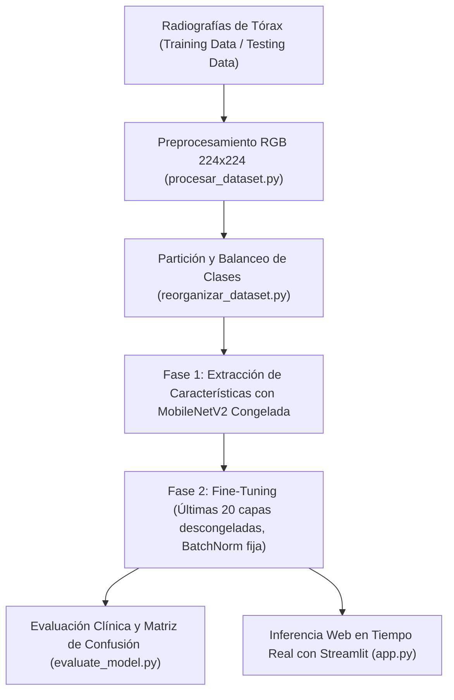

# Documentación Técnica: AI in HealthCare - Chest Disease Detection
**Autor:** Roberto Alejandro Chagra Martínez  
**Tecnologías:** TensorFlow / Keras (MobileNetV2), Streamlit, Pillow (PIL), Scikit-Learn, Seaborn, Matplotlib, NumPy  
**Tipo:** Clasificación Radiológica Pulmonar Multiclase con Transfer Learning  

---

## 1. Descripción del Proyecto
Solución de diagnóstico radiológico asistido por Inteligencia Artificial para clasificar enfermedades torácicas en 4 categorías (`Bacterial Pneumonia`, `Healthy`, `Viral Pneumonia` y `covid-19`) a partir de radiografías digitales de tórax (X-Rays) de $224 \times 224$ píxeles.

---

## 2. Flujo de Datos y Componentes (`Proyectos/lung-pathology-ai`)
* `procesar_dataset.py`: Auditoría de integridad de imágenes, conversión a `RGB`, redimensionamiento a $224 \times 224$ con interpolación `LANCZOS` y exportación en JPEG usando rutas dinámicas (`os.path.dirname(os.path.abspath(__file__))`).
* `reorganizar_dataset.py`: Mezcla y partición aleatoria entre los directorios locales `Training Data/` y `Testing Data/`.
* `train_model.py`: Entrenamiento en dos fases sobre **MobileNetV2** (`weights='imagenet'`, `include_top=False`) con `GlobalAveragePooling2D`, `Dense(128, activation='relu', l2=0.01)`, `Dropout(0.4)` y `Dense(4, activation='softmax')`, ponderación de clases (`compute_class_weight('balanced')`) y exportación de `models/modelo_chest_disease.keras` y `config/mapeo_clases.json`.
* `evaluate_model.py`: Reporte de métricas diagnósticas (`classification_report`) y generación de `results/matriz_confusion.png` (300 DPI).
* `app.py`: Interfaz web interactiva en **Streamlit** para carga de radiografías e inferencia con distribución porcentual de confianza por patología.
